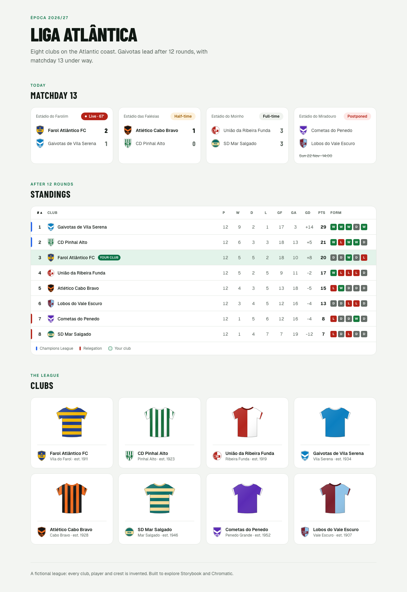
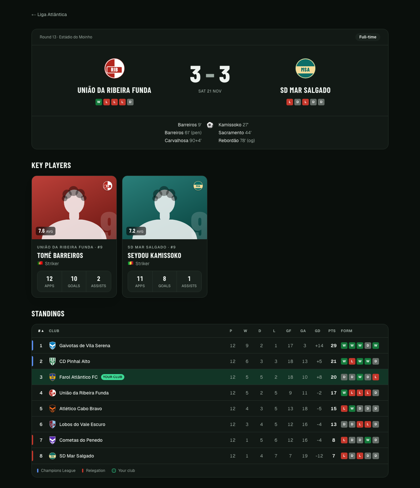

# Liga Atlântica

A fictional eight-club Portuguese football league: a small, production-minded Next.js app built
to show what a modern **Storybook 10 + Chromatic** workflow looks like end to end, including
interaction, accessibility and visual tests, mocked APIs, and AI agents that build UI from the
component library through the Storybook MCP server.

Every club, player and crest is invented.



**Stack:** Next.js 16 (App Router, Cache Components), React 19, TypeScript, Tailwind 4,
Storybook 10.6 (`@storybook/nextjs-vite`, CSF Factories), Vitest 4 + Playwright, MSW 2, Chromatic.

## Run it

```sh
npm install
npm run dev            # the app → http://localhost:3000
npm run storybook      # Storybook → http://localhost:6006
npm test               # unit tests + every story as a test (render, play function, a11y)
npm run lint && npm run typecheck
npm run chromatic      # visual tests (needs CHROMATIC_PROJECT_TOKEN, see below)
```

`npm test` reports **1 failure on purpose**: `KitPreview → Low Contrast Nameplate` breaks WCAG
contrast to show the a11y checks catching it. CI skips it (`CI=1 npm test` shows that locally).

## The app

- **Home:** today's fixtures, the league table and every club's kit and crest.
- **Match page** (`/match/r13-farol-gaivotas`): score, scorers, key players (click one for a
  profile dialog) and standings.
- **Automatic dark mode:** follows the OS. Every token is a CSS `light-dark()` pair, so there's
  one source of truth for both themes.



### How the match page gets its data

```
Server: page.tsx ──getMatchCentre(id)──▶ <MatchCentre initialData>  (HTML has the score, no spinner)
                     └─ unknown id → notFound()
Client: MatchCentre ──while live: poll GET /api/matches/:id every 30s──▶ re-render
                     └─ no initialData (stories) → fetch → loading / error / retry
```

The data-fetching component (`MatchCentre`) is kept separate from the pure view (`MatchView`).
That's what makes both easy to test: the view takes props, and the data lifecycle is tested
against a fake network with MSW.

### Quality and security

- **Accessible by default.**
  - Every story runs axe checks that fail the test.
  - Keyboard-sortable table headers use `aria-sort`.
  - Card links cover the whole card, with screen-reader context added.
  - The native `<dialog>` handles focus.
  - Live dots and hover lifts respect `prefers-reduced-motion`.
- **Deterministic data.** The season is simulated from a seeded random generator, and unit tests
  check its invariants: points, goal totals, ordering and squad integrity. Same pixels on every
  run, which visual testing depends on.
- **Hardened API and headers.**
  - The API validates match ids (400 if malformed) and sends live data with `Cache-Control: no-store`.
  - All routes send `nosniff`, `X-Frame-Options: DENY`, a strict `Referrer-Policy` and a locked-down
    `Permissions-Policy`.
  - The `x-powered-by` header is off.
- **No secrets in the repo.** The Chromatic token comes from the environment or a CI secret.

## Storybook: what's where

| Feature | Where to look |
| --- | --- |
| **CSF Factories** (`preview.meta` / `meta.story`) | Every `*.stories.tsx`; config in `.storybook/main.ts` + `preview.tsx` |
| **Args & controls**, colour pickers, `mapping` | `KitPreview`, `PlayerCard`, `FixtureCard` (club selects map id → object) |
| **Decorators + globals**: light/dark toolbar | `.storybook/preview.tsx` |
| **Viewports**: presets + pinned per story | `preview.tsx`; `Mobile` stories use `globals.viewport` |
| **Play functions** | `LeagueTable → Sort By Points`, `PlayerCard → Selectable`, `Pages/Match → Open Player Details`, `Match Centre → Retry After Error` / `Live Score Update` |
| **Vitest addon** | `vitest.config.ts`; run from the terminal (`npm run test:stories`) or the sidebar's *Run tests* |
| **A11y addon** (`a11y.test: "error"`) | Every story passes, except the deliberate `Low Contrast Nameplate` |
| **MSW** network mocking | `Pages/Match Centre (network)`: success, loading, network failure, 500, 404, empty, retry, live update |
| **Autodocs + MDX** | Every component's *Docs* page; `src/GettingStarted.mdx` |
| **MCP + component manifests** | `.storybook/main.ts`, `AGENTS.md`, `.mcp.json` |
| **Chromatic modes** (light + dark snapshots) | `parameters.chromatic.modes` in `preview.tsx` |

**Tests:** 81 in total.
- **Story tests (`npm run test:stories`):** every story renders in real Chromium, then its play
  function and axe checks run.
- **Unit tests (`npm run test:unit`):** data integrity, colour-contrast maths and the API route.

## AI: Storybook MCP

With Storybook running, agents get an MCP server at `http://localhost:6006/mcp`.
- **Claude Code:** registered in `.mcp.json`.
- **Other agents:** `npx mcp-add --type http --url "http://localhost:6006/mcp" --scope project`.

`AGENTS.md` tells agents to:
- look components up (`docs-list` / `docs-show`) before writing UI
- preview their changes (`stories-preview`)
- validate with `test-run`

Browse what agents see at <http://localhost:6006/manifests/components.html>.

Each component's JSDoc carries an `@import` tag, so agents copy the real import path rather than a
guessed one. Showcase and deliberately broken stories are tagged `!manifest`, so agents never learn from them.

**Compare agents with and without MCP** (fresh session each; disable `.mcp.json` for "without"):

1. *"Add a 'Top scorers' section to the home page showing the 5 leading scorers in the league."*
   Does it reuse `PlayerCard` + `playerCardProps` and theme tokens, or hand-roll markup?
2. *"Build a ClubProfile component with crest, kit, recent form and squad, plus stories."*
   Does it compose `Crest` / `KitPreview` / `FormGuide` with real props and write CSF Factories?
3. *"Make LeagueTable rows compact on mobile and add a `dense` option."*
   Does it check existing props first, then preview and run `test-run`?

## Chromatic

1. Create a project at <https://www.chromatic.com/start> (linking this GitHub repo) and copy
   its project token.
2. Run locally. The token is read from the environment; never commit it:

   ```sh
   export CHROMATIC_PROJECT_TOKEN=<your token>
   npm run chromatic
   ```

3. For CI, add the token as the repository secret `CHROMATIC_PROJECT_TOKEN`.
   `.github/workflows/ci.yml` runs on every PR, and on `main` to update the baselines:
   - **Lint + typecheck**
   - **Vitest:** unit, interaction and a11y tests in headless Chromium.
   - **Chromatic:** visual tests with **TurboSnap** (`onlyChanged`), so only stories whose files
     changed get re-snapshotted. Needs `fetch-depth: 0`.

Options live in `chromatic.config.json`:
- `onlyChanged`: turns on TurboSnap.
- `externals: public/**`: a change to static assets re-tests everything.
- Changes are auto-accepted on `main`.
- `exitZeroOnChanges`: visual changes are reviewed in Chromatic's UI instead of failing the CLI.

### The regression branch

`demo/visual-regression` has three deliberately subtle bugs, each one innocent-looking commit:

| Bug | Change | Stories that should light up |
| --- | --- | --- |
| PlayerCard padding | body `p-4` → `p-[18px]` (+2px) | all PlayerCard stories, Pages/Match, Match Centre |
| KitPreview hoops | hoops drawn 12% darker than the collar and cuffs | KitPreview Hoops, PlayerDialog (Farol), Showcase/Clubs, Pages/Home |
| LeagueTable rows | position number nudged 2px below the rest of the row | all LeagueTable stories, Pages/Home, Pages/Match |

Every test still passes on that branch. These are pixel bugs that only visual testing catches.

## What to show in a 5-minute demo

1. **(0:30) The product.** Open the app: matchday, table, a live match, click a player. Flip the
   OS to dark mode. *"This is the thing we ship. Everything after this is how we keep it right."*
2. **(0:45) Storybook as the workshop.** *Getting started*, the theme toolbar, `KitPreview → Hoops`
   with the colour pickers. *"Stories are the unit: docs, tests and visual baselines all hang
   off them."*
3. **(1:00) Tests that read like a user.** `LeagueTable → Sort By Points`: step through the
   Interactions panel. `Match Centre → Live Score Update`: MSW serves a new score and the play
   function watches it arrive. Hit *Run tests* in the sidebar, then `npm test` in the terminal:
   same tests.
4. **(0:30) Accessibility.** `Low Contrast Nameplate`: the a11y panel shows 1.58:1 against the
   required 4.5:1. That's a real kit combination that a test caught.
5. **(1:00) Visual regression.** Open the Chromatic build for `demo/visual-regression`: three
   tiny diffs that no test caught, in light *and* dark. Point at the TurboSnap count, which shows
   unaffected stories were skipped.
6. **(1:15) AI.** Ask Claude Code *"Add a Top scorers section to the home page"*. It calls
   `docs-list` → `docs-show PlayerCard` → `stories-preview` → `test-run`, reusing real components
   instead of inventing props.

**For a non-technical audience:** lead with steps 1, 4 and 5. *"A designer's 2px matters. Here's
the tool that notices it before customers do."*
